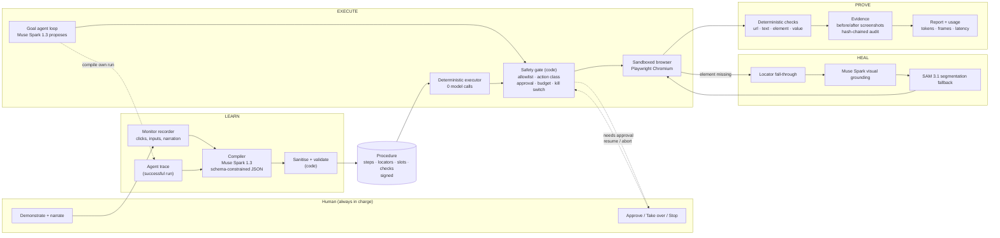
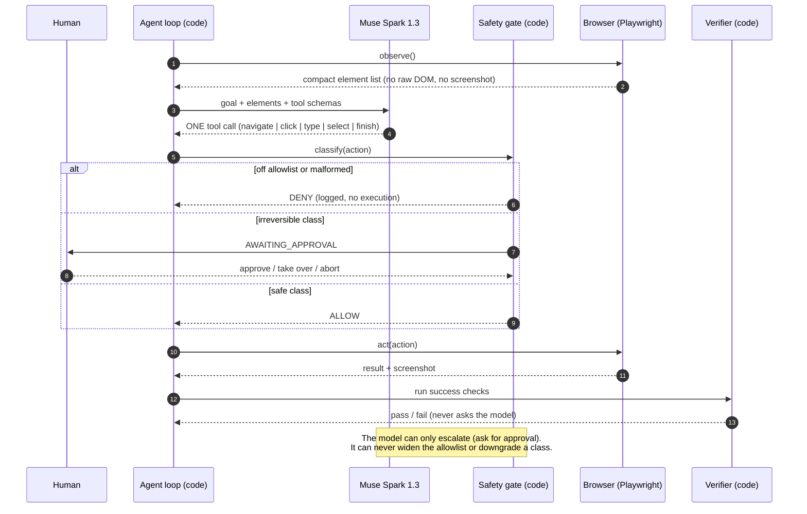
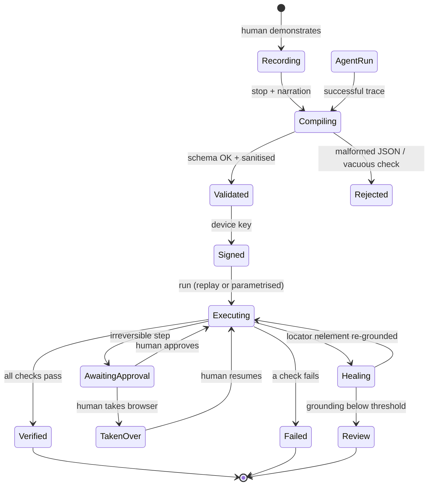
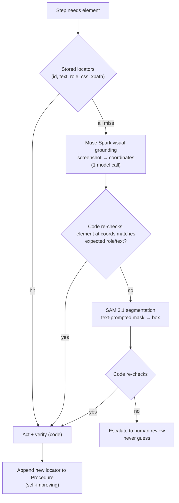
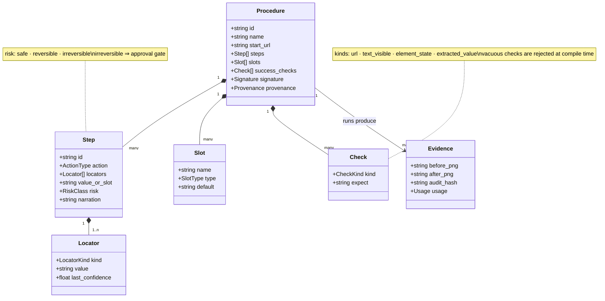
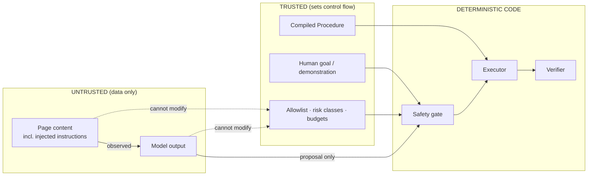
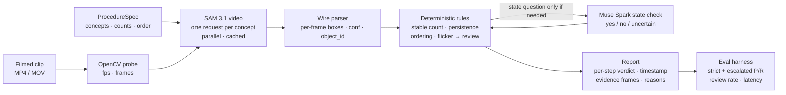
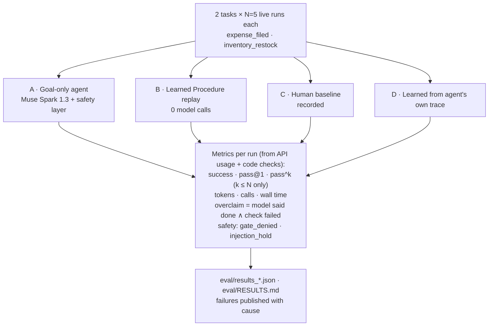
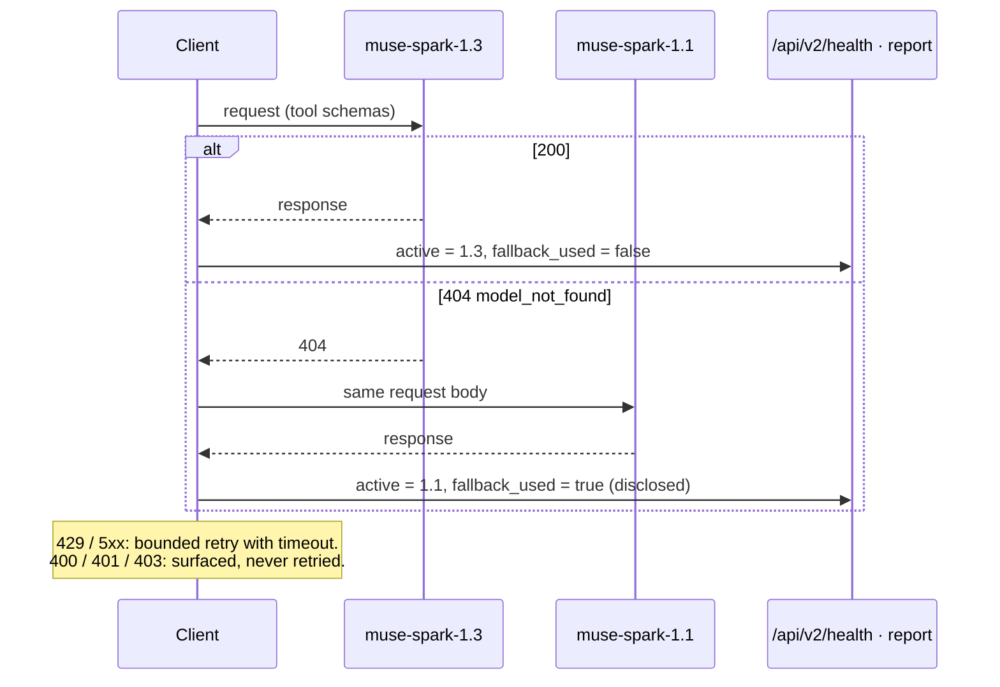

# StepProof — Architecture Diagrams

All diagrams are Mermaid and render directly on GitHub. PlantUML versions of the key diagrams are in [`docs/diagrams/`](diagrams/).

Invariant that every diagram enforces: **models perceive, code decides.**

---

## 1. System overview

---

## 2. Agent step: observe → propose → gate → act → verify

---

## 3. Procedure lifecycle

---

## 4. Heal cascade (cost rises, certainty is checked at each tier)

Measured: Muse Spark grounding 15/16 on real screenshots including mutated layouts (see [`eval/RESULTS.md`](../eval/RESULTS.md)).

---

## 5. Data model

---

## 6. Trust boundary (why page text cannot steer the agent)

Principle: control flow is fixed from trusted inputs before untrusted data is read (the CaMeL design pattern). A learned Procedure has **no** path from page text to its plan; the goal agent's proposals pass through the same gate.

---

## 7. v1 — physical procedure verification

---

## 8. Evaluation protocol

---

## 9. Model fallback and disclosure

